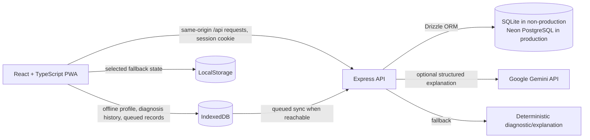

# MindTrace

**AI-powered mathematics learning that helps students understand where their reasoning goes wrong, with offline-first accessibility.**

## Overview

MindTrace is an offline-first mathematics diagnostic and learning platform for Nigerian secondary school students (SS1–SS3) and their teachers. Rather than treating every incorrect answer as the same, it inspects a learner's working, identifies likely misconceptions and offers a targeted explanation or practice step. Teachers can organize classrooms, publish assignments and review submitted work and diagnostic information.

The project is motivated by real experiences of mathematics-related academic struggles and the way repeated difficulty can undermine confidence and limit educational opportunities. MindTrace aims to make feedback more useful and learning resources more accessible when connectivity is slow, costly or intermittent.

## The problem and our approach

Conventional answer-based assessment often reports only right or wrong. It may not reveal where reasoning changed direction, and students do not always have access to individualized mathematical guidance. Reliable internet access is also not a safe assumption in every classroom.

MindTrace combines a deterministic mathematics diagnostic engine with optional AI-assisted, contextual explanations. Local learning state and diagnostic records can be stored in IndexedDB and queued for later synchronization. The deterministic path is available when the AI service or network is not.

## Features in this repository

- Step-oriented mathematics diagnosis using the existing deterministic edge rule engine.
- Identification of supported misconceptions and their associated faulty step/evidence.
- Optional Gemini-generated contextual explanations with confidence/abstention handling and deterministic fallback.
- Student dashboard, practice, diagnostic history, progress, remedy/intervention and mastery-check flows.
- Teacher workspace with classroom management, student roster, assignments, submission review, analytics views, curriculum question bank and chalkboard script tools.
- Progressive Web App manifest, install prompts and service-worker registration.
- IndexedDB-backed local profiles, diagnosis history and synchronization queue, with a LocalStorage fallback for selected data.
- Connectivity status and an explicit simulated-offline mode for exercising offline behavior.

Feature state varies by route and available data. Some teacher dashboard visualizations and curriculum content are currently static or incomplete; see [Current limitations](#current-limitations). Do not interpret an empty state as fabricated or seeded classroom data.

## User journeys

### Student

1. Register or sign in as a student.
2. Select a mathematics activity and enter working steps.
3. Review the deterministic diagnosis and (when configured and reachable) a contextual AI explanation.
4. Continue to the linked intervention or follow-up flow, and review progress/history.
5. Work locally while offline; pending records remain queued for a later sync attempt.

### Teacher

1. Register with a username, email, password and school/institution information; designation and subjects are also supported.
2. Sign in through the server-backed authentication endpoints.
3. In an explicitly configured demo environment, authenticated teacher accounts may enter the workspace without approval/token gating. Outside demo mode, the existing accreditation and administrator-approval policy remains.
4. Manage owned classrooms, roster, assignments, submissions and analytics where the corresponding endpoints and records are available.

No shared password or public demo account is documented. Create a unique account in the environment you control.

## AI architecture

The server-side reasoning service invokes Google Gemini using the model identifier currently configured in the code: `gemini-3.8-flash`. It receives a deterministic diagnosis as a baseline and requests a structured explanation, evidence, pedagogical suggestion and confidence signal. Low-confidence or ambiguous responses can abstain; missing API credentials, empty/error responses and timeout conditions use the deterministic explanation fallback. AI does not replace the deterministic diagnostic result or independently award XP.

Model availability and API access depend on the configured Google AI account and may change independently of this repository. Keep `GEMINI_API_KEY` on the server only.

## Technology

- **Frontend:** React 19, TypeScript, Vite, Tailwind CSS 4.
- **Backend:** Node.js, Express, TypeScript (`tsx` for development and esbuild for server bundling).
- **Persistence:** Drizzle ORM; PostgreSQL/Neon schema and migrations, plus SQLite via `better-sqlite3` for non-production server operation. Browser persistence uses IndexedDB and selected LocalStorage fallback data.
- **AI:** Google GenAI SDK (`@google/genai`) and deterministic edge reasoning fallback.
- **Authentication/security:** Express sessions and HTTP-only cookies; server-side Argon2 password service; role checks; teacher verification middleware; classroom ownership checks in routes; CSRF token support and authentication rate limiting.
- **Offline/PWA:** Web manifest, service-worker registration, IndexedDB diagnostic store and synchronization queue.

Configuration and implementation details should be checked in source before changing hosting or database setup. In particular, the current non-production database selection is SQLite, while `db:migrate` runs Drizzle migrations against PostgreSQL.

## Architecture



In the current development server, Express serves the Vite middleware from one origin on port 3000. The `/api/health` endpoint reports API process health and a database connectivity field; a successful health HTTP status does not necessarily mean a production database is connected.

## Local development

### Prerequisites

- Node.js compatible with the versions used by the installed Vite/toolchain and npm.
- npm (the repository includes `package-lock.json`).
- Optional: a Google Gemini API key to exercise generated explanations.
- Optional: Neon PostgreSQL credentials if running production-like database migrations/deployment.

### Install and configure

```bash
git clone https://github.com/Ifeoluwayemisi/mindtrace.git
cd mindtrace
npm install
cp .env.example .env
```

Edit `.env` for your environment. Keep secrets out of source control. The local development database file is `mindtrace_dev.db`; the database layer selects SQLite whenever `NODE_ENV` is not `production`.

### Enable teacher demo access (local demo only)

Set the backend environment variable:

```dotenv
NODE_ENV=development
MINDTRACE_DEMO_MODE=true
```

Then start the app as below. Demo mode only relaxes the teacher accreditation/approval gate after the server has verified an authenticated teacher session and a teacher profile. It does not grant teacher role to a student, remove authentication, or bypass ownership checks. The backend rejects this setting when `NODE_ENV=production`.

### Run the app and checks

The scripts currently defined in `package.json` are:

```bash
npm run dev
npm run lint
npm run build
npm run db:generate
npm run db:migrate
npm run preview
npm start
```

`npm run dev` starts Express and its Vite middleware together at port 3000. `npm run lint` is the configured TypeScript no-emit check. `npm run build` builds the Vite client and bundles the server. `npm run db:generate` generates Drizzle migrations from the PostgreSQL schema; `npm run db:migrate` applies migrations using `DIRECT_URL` or `DATABASE_URL` and therefore requires a PostgreSQL connection. `npm run preview` starts the Vite preview server, not the Express API. `npm start` starts the built API entry point.

There is no dedicated test script defined in `package.json`. Existing audit/test files are under `src/tests`; inspect and invoke them with their intended runtime if using them. Do not treat `npm run lint` as a test suite.

## Environment variables

| Variable | Purpose |
| --- | --- |
| `NODE_ENV` | Selects development/production server behavior and DB implementation. |
| `PORT` | Present in the example configuration; the current `server.ts` binds port 3000 directly. |
| `MINDTRACE_DEMO_MODE` | Server-only teacher approval bypass for demos; `true` is rejected in production. Default/off unless set to `true`. |
| `DATABASE_URL` | Neon connection string for the production database. |
| `DIRECT_URL` | Direct PostgreSQL URL used by Drizzle migration configuration when present. |
| `SESSION_SECRET` | Session signing secret; provide a unique long random secret. |
| `ARGON2_PEPPER` | Server authentication pepper configuration. |
| `GEMINI_API_KEY` | Optional server-only Google Gemini API key; deterministic explanation is used without it. |

Never use a `VITE_` prefix for server secrets, commit real `.env` files, or use sample connection strings as credentials. The existing server code contains fallback/default security settings that should be replaced with explicitly configured secrets before a real production deployment.

## Offline and PWA behavior

MindTrace registers a service worker and provides a web manifest and install UI. Browser installation is available through the browser's install/Add to Home Screen UI where supported; on Chromium desktop/mobile, use the install icon or browser menu, and on iOS Safari use **Share → Add to Home Screen**.

The source implements IndexedDB stores for profiles, diagnosis records, sync queue and teacher aggregations, plus LocalStorage fallbacks for some records. The deterministic diagnostic and local learning flows can operate without a network once the app assets are available locally. Server registration/login, classroom and assignment APIs, cloud sync, Neon persistence and Gemini explanations require an available backend (and Gemini requires its key/network). The service worker's exact precache and runtime cache scope is defined in `public/sw.js`; offline availability of every route/API should not be assumed.

## Security and privacy

- Server login/registration use the server authentication service and password hashing; sessions are delivered using HTTP-only cookies.
- Authorization trusts the backend session role, not a frontend role/localStorage value. Demo mode bypasses only teacher approval status, not teacher role or profile checks.
- Teacher endpoints retain classroom ownership predicates; assignment and analytics routes also contain access checks. Student APIs retain their student-role/membership rules.
- Authentication endpoints use rate limiting; CSRF token support is implemented in the API client and middleware.
- Gemini keys and session/database secrets belong only in server environment configuration. Avoid entering identifiable student data into non-approved demo or third-party environments.

Review deployment-specific cookie, CORS, CSRF, secret management, data retention and privacy requirements before using real student data. A demo configuration is not a substitute for production accreditation policy.

## Project structure

```text
.
├── api/                      # Bundled API output for deployment
├── public/                   # PWA manifest, service worker, icons and static assets
├── scripts/                  # Project utility scripts
├── src/
│   ├── components/           # Authentication, student, teacher, layout and shared UI
│   ├── data/                 # Question and application data
│   ├── db/                   # Drizzle schemas, migration runner and migrations
│   ├── middleware/           # Authentication, role, teacher-approval and CSRF middleware
│   ├── routes/               # Express API route modules
│   ├── services/             # Auth, diagnostics, AI, analytics, storage and sync services
│   ├── tests/                # Audit/test scripts present in repository
│   ├── types/                # Shared TypeScript types
│   └── utils/                 # Shared utilities
├── server.ts                 # Express API and Vite development integration
├── package.json              # Scripts and dependencies
├── vite.config.ts            # Vite configuration
├── drizzle.config.ts         # PostgreSQL migration generation config
└── vercel.json               # Build/output configuration
```

## Current limitations

- There is no `test` script in `package.json`; route-level end-to-end coverage is not configured through a standard test runner in the current scripts.
- Some teacher insight chart content and curriculum question actions are static/incomplete in the current UI; do not treat them as persisted analytics or fully wired authoring flows.
- The teacher dashboard client currently has a verification-pending screen. Backend demo mode removes the server authorization barrier, but client rendering must also consume authoritative demo mode/session state for pending existing users to see the workspace consistently; verify this integration before a demo release.
- The current `server.ts` uses a fixed development port, and deployment/static API routing, cookie settings, and production database setup should be validated against the target host.
- Offline cache/sync behavior depends on service-worker cache policy and server availability; not every teacher operation is available offline.
- Assignment late/retake policy enforcement and any other incomplete workflow should be reviewed in its route implementation before relying on it operationally.

## Roadmap

- Pilot with Nigerian secondary-school learners and teachers, with informed consent and privacy safeguards.
- Expand curriculum coverage and validated misconception rules with educator feedback.
- Improve diagnostic evidence, confidence calibration and quality review of localized explanations.
- Strengthen offline installation, queued synchronization, conflict handling and low-bandwidth reliability.
- Partner with schools and educators to validate classroom workflows and accessible learning materials.

## Contributors

The repository history verifies contributions by **Ifeoluwayemisi** and **Racheal Oluwayemisi**. Specific project roles and contribution allocations have not been independently documented here; add verified role descriptions with contributor agreement rather than guessing.

## Hackathon

MindTrace is developed for the **Wale Lab NextGen AI Hackathon**, selected challenge track: **AI for Zero-Bandwidth & Localized Learning**.
